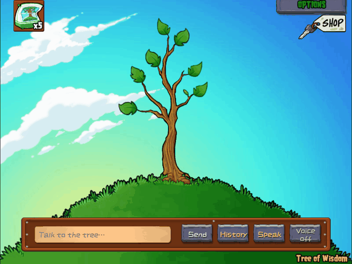
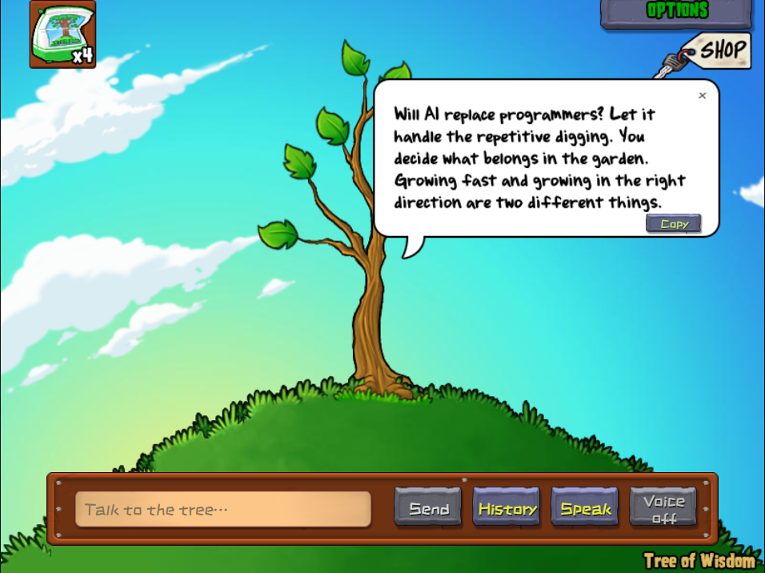

<div align="center">

# Tree of Wisdom · 智慧树

### Your childhood tree has something new to say.
### 小时候给它施肥，现在听它聊聊世界。

A playable PvZ GOTY Tree of Wisdom with AI conversation, manual growth, and a tiny economy that turns model usage into tree food.

[**Download for Windows**](https://github.com/ShiroPpu69/wise-tree/releases/latest) · [**中文介绍**](README.zh-CN.md) · [**Quick start**](#run-from-source) · [**Roadmap**](#where-it-stands)




*Actual desktop capture · isolated demo save · local streamed chat fixture · silent GIF.*

</div>

## A garden you can talk to

Remember buying a bag of Tree Food just to hear what the tree would say next?

**wise-tree** brings that little ritual into a standalone app. Ask about code, complain about your day, or ask the tree an impossible question. Replies appear inside the game scene, in a comic speech bubble. Meanwhile, model usage builds up into coins. Spend them at Crazy Dave's shop, take the food back, and feed the tree yourself.

The goal is to preserve the GOTY tree's character, scenery and hands-on growth while making conversation part of the game.

## What you can do

- **Talk inside the garden.** Stream replies into an adaptive bubble; scroll long answers and copy text or code without paging through dozens of screens.
- **Grow it by hand.** Start at 1 foot with 5 bags. One bag adds one foot. Tall trees keep the trunk view, with no automatic zoom-out.
- **Keep the shop in the loop.** Provider-reported tokens become coins; coins buy Tree Food. Chat never feeds the tree for you.
- **Bring your model.** Presets for DeepSeek, OpenAI, Qwen, Kimi and GLM, plus custom OpenAI-compatible Chat Completions endpoints.
- **Let the voice grow too.** Optional online speech with child, young and mature stages; playback starts **off**. System/custom TTS and editable speech-input transcripts are also available.
- **Remember what matters.** Local chat history and separately managed, explicitly saved memories. Export/import saves without plaintext API keys.
- **Find familiar secrets.** Height-gated `daisies`, `dance`, `pinata`, plus other original commands in an independent easter egg demonstration scene.

| Talk | Shop |
|:---:|:---:|
|  |  |

The demo response is authored for this project and streamed through a local test server. It is **not** original GOTY dialogue or a live model-service benchmark. [Capture details](docs/media/README.md).

## The little economy

```text
Talk → accumulate 20,000 tokens → receive 2,500 coins
     → buy 1 bag at Dave's shop → feed it yourself → grow 1 foot
```

Tree Food costs **2,500 coins**, with a **10-bag inventory limit**. Unredeemed token progress survives restarts. Settlement IDs prevent duplicate rewards; purchases and feeding use local transactions. Missing or unreliable usage does not silently become exact credit. Future exchange rates are configurable without recalculating past rewards.

## Install on Windows

1. Download the **Windows x64 installer** from [Releases](https://github.com/ShiroPpu69/wise-tree/releases/latest).
2. Install and launch **智慧树 / Tree of Wisdom**. This repository's release includes the game resources; no game launch or separate resource import is required.
3. Open **Options → AI Model**, choose a provider, enter your own key and model, then save and test.
4. Start chatting. Click **Voice off** when you want replies read aloud.

The initial interface is Simplified Chinese. Change it under **选项 → 常规 → 语言**. Local growth and the shop work without an AI connection; AI service charges depend on your provider. The Windows installer is currently unsigned.

## Run from source

Use **Node.js 24** and npm. Windows x64 is the tested desktop target.

```bash
git clone https://github.com/ShiroPpu69/wise-tree.git
cd wise-tree
npm ci
npm test
npm run build
npm run desktop
```

For Web development, run `npm run dev` and open `http://127.0.0.1:5180`. In the browser, select the repository's `resources/goty/main.pak` once; assets are cached locally. Production Web output is `dist/web/`. Browser requests depend on provider CORS support; keys are kept in memory unless the user explicitly chooses persistence. No unknown third-party proxy is injected.

Build the Windows installer on Windows:

```bash
npm run dist:win
```

Output: `private/releases/智慧树 安装程序 0.1.14.exe`. `private/` is ignored local output, not a missing source dependency. The checked-in resource manifest records hashes for the bundled files.

## How it is built

| Layer | Responsibility |
|---|---|
| React + PixiJS | Original-resource scene, Reanim playback, interaction and game-style settings |
| Game / storage cores | Growth, ledger, deduplicated settlement, IndexedDB transactions and recovery snapshots |
| AI core | Provider configuration, streamed requests, context, character prompt and usage |
| Voice core | Independent TTS/STT adapters, ordered playback, cancellation and bounded in-memory cache |
| Electron | Isolated renderer, restricted IPC and Windows encrypted credential storage |
| Asset pipeline | Audited PAK import, compiled Reanim, bitmap fonts and resource provenance |

Windows and Web share the TypeScript cores. The developer harness uses an isolated database; test rewards are not exposed in the production UI.

## Where it stands

**0.1.14 is a usable development release, not a claim of complete GOTY fidelity.** There are 64 unit tests in the local asset-enabled run, plus targeted desktop/browser checks. Tests requiring locally extracted research fixtures may skip in a fresh checkout.

Still to verify or improve:

- Every target height, animation/audio timing and the full ≤2-logical-pixel visual comparison.
- Live acceptance with DeepSeek and a second provider; protocol fixtures do not replace that.
- Speech-input quality and voice reliability across more machines. The free online voice is a public research demo and may queue, fail or change; it receives spoken text and can cache generated audio.
- Complete cross-platform parity. The Web version does not currently have the same no-key desktop speech bridge.
- Chinese resource provenance: the UI uses an OFL supplemental font; the included community localization is not independently verified as official Chinese GOTY.

Useful reading: [architecture](docs/architecture.md) · [original-resource research](docs/phase-0-report.md) · [animation evidence](docs/animation-research.md) · [tests and scope](docs/validation.md) · [publication notes](docs/publishing.md).

## Help it grow

Good reports are welcome: tell us the app version, Windows/browser version, steps to reproduce and what happened. A screenshot or a short recording helps more than “it doesn't work.” **Never attach keys, private chats or personal saves.**

Especially useful contributions: original-game visual comparisons, robust provider adapters, voice fallbacks and reproducible tests. Please open an issue before proposing a major renderer rewrite. [Contributing](CONTRIBUTING.md).

If a talking tree belongs on your desktop, a **star** helps other people find it.

## License and credits

Original application code and documentation: **[MIT](LICENSE)**. **Game resources are excluded from MIT.** The included Plants vs. Zombies artwork, audio, animation, dialogue, game-derived icons and depicted artwork remain the property of their respective rights holders. See [resource provenance and rights](resources/README.md), [demo media](docs/media/README.md), and [third-party notices](THIRD_PARTY_NOTICES.txt).

An independent fan project, not affiliated with or endorsed by PopCap or Electronic Arts. Research references are credited in the technical documents; their code and licenses are not replaced by this project's MIT license.
