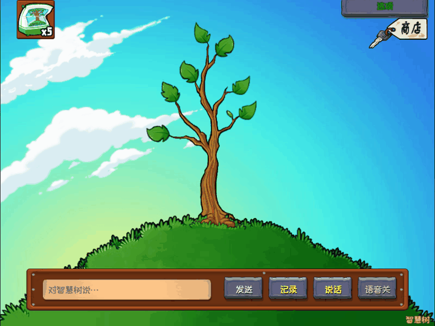
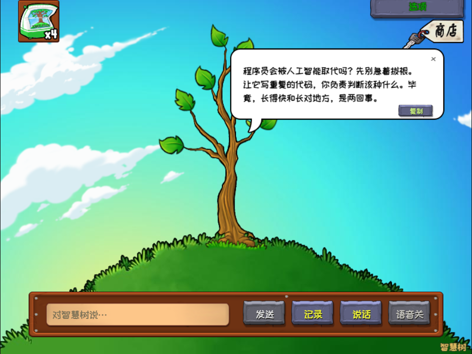

<div align="center">

# 智慧树 · Tree of Wisdom

### 小时候给它施肥，现在听它聊聊世界。

把《植物大战僵尸》GOTY 的智慧树搬到桌面：聊聊天、攒金币、去戴夫商店买肥料，再亲手把它养大。

[**下载 Windows 安装包**](https://github.com/ShiroPpu69/wise-tree/releases/latest) · [**English**](README.md) · [**源码运行**](#源码运行) · [**当前进度**](#当前进度)


[](https://github.com/ShiroPpu69/wise-tree/actions/workflows/check.yml)



*真实程序录制 · 独立演示存档 · 本地模拟流式回复 · 动图无声*

</div>

## 一棵能聊起来的智慧树

还记得为了听一句新提示，攒金币给智慧树买肥料吗？

现在，你可以问它代码怎么写、今天为什么这么累，或者人工智能会不会取代程序员。它依然站在那片草地上，用漫画气泡慢慢回答。聊天积累的模型用量变成金币，你再去戴夫的商店买树肥，回来亲手施肥。

这个项目希望保留原版的场景、性格和养树仪式，让 AI 对话成为游戏里自然发生的事情。

## 现在可以玩什么

- **在原版场景里聊天**：流式回复、逐字显示；短回答用小气泡，长回答在限定尺寸内滚轮阅读，可复制全文和代码。
- **亲手把树养大**：初始 1 英尺、5 袋免费树肥，一袋长高 1 英尺。高树保留树干视角，不自动缩小。
- **聊天 → 金币 → 商店 → 树肥**：保留完整购买过程，聊天不会自动替你施肥。
- **接入自己的模型**：支持 DeepSeek、OpenAI、通义千问、Kimi、智谱预设及其他 OpenAI 兼容 Chat Completions 接口。
- **声音跟着树长大**：可选儿童、年轻、成熟三个阶段的联网朗读，也可自配语音服务。安装后默认「语音关」，点击即可开启。
- **记录与记忆留在本地**：聊天记录和长期记忆分开管理；重要信息由用户明确保存，支持删除和存档导入导出。
- **找回那些隐藏指令**：100、500、1000 英尺对应解锁，以及其他原版指令的独立彩蛋演示。
- **中英文界面**：统一的游戏风格选项窗口；Windows 与 Web 共用核心逻辑。

| 和它聊聊 | 去戴夫商店 |
|:---:|:---:|
|  |  |

演示回复由本项目编写，通过本地模拟接口流式传入，**不是原版台词，也不冒充真实服务商测试**。施肥、动画、气泡及按钮均在实际程序中运行。[录制说明](docs/media/README.md)。

## 养树的小循环

```text
聊天累计 20000 Token → 获得 2500 金币
                    → 商店购买 1 袋树肥 → 手动施肥 → 长高 1 英尺
```

树肥售价 **2500 金币**，库存上限 **10 袋**。不足兑换门槛的进度跨会话保留，同一次请求不能重复奖励。优先采用服务商返回的准确用量；没有可靠统计时，不会偷偷按字符数发金币。兑换比例可调整，历史已发金币不重新计算。

## 下载安装

1. 到 [Releases](https://github.com/ShiroPpu69/wise-tree/releases/latest) 下载 **Windows x64 安装程序**。
2. 安装后直接打开「智慧树」，资源随包提供，无需另行导入，也无需启动原版游戏。
3. 右上角 **选项 → 对话模型**，选择服务商，填写自己的 Key 和模型，保存并测试连接。
4. 输入问题即可聊天；需要朗读时，点击「说话」右侧的 **语音关** 切为 **语音开**。

默认简体中文；「说话」用于录音识别，识别结果先进入输入框，确认后再发送。离线时仍能使用本地施肥、成长和商店。模型调用是否收费由服务商决定，免费朗读不代表模型调用免费。当前安装程序尚未购买代码签名证书。

## 源码运行

使用 **Node.js 24** 和 npm。桌面端当前验证目标为 Windows x64。

```bash
git clone https://github.com/ShiroPpu69/wise-tree.git
cd wise-tree
npm ci
npm test
npm run build
npm run desktop
```

Web 开发：`npm run dev`，打开 `http://127.0.0.1:5180`。浏览器首次选择仓库中的 `resources/goty/main.pak`，之后使用本地缓存。生产构建位于 `dist/web/`。浏览器直接调用模型接口受服务商跨域策略影响，桌面版可使用受限请求桥；项目没有默默转发 Key 的第三方代理。

在 Windows 构建安装程序：

```bash
npm run dist:win
```

输出为 `private/releases/智慧树 安装程序 0.1.14.exe`。这里的 `private/` 是被 Git 忽略的本地产物目录，正常构建不依赖开发者的私有资源目录。仓库内的素材哈希见 [资源清单](resources/manifest.json)。

## 工程结构

| 模块 | 职责 |
|---|---|
| React + PixiJS | 场景、原版 Reanim 播放、游戏交互及设置 |
| Game / Storage Core | 成长、金币账本、用量去重、事务、恢复快照 |
| AI Core | 服务适配、流式请求、上下文、人格与用量 |
| Voice Core | 独立 TTS/STT、播放队列、取消与有限内存缓存 |
| Electron | 进程隔离、受限 IPC、系统加密凭据存储 |
| Asset Pipeline | PAK 解析、动画、位图字体与资源溯源 |

开发者测试入口使用独立数据库，不把模拟金币奖励接口放进正式界面。

## 当前进度

**0.1.14 是可安装使用的开发试用版，还没有完成所有原版还原验收。** 本地具备研究资源时，64 项单元测试通过，并有针对性的桌面和浏览器运行检查。全新克隆中，依赖未提交提取样本的研究测试会跳过。

仍需继续完成：

- 所有关键高度、动画和声音时序，以及完整的 ≤2 逻辑像素视觉对照。
- DeepSeek 加第二服务商的真实验收；本地接口夹具不等于真实服务实测。
- 更多电脑上的语音输入和播放验证。免费联网语音使用公开研究体验服务，可能排队、失败或变更；朗读文本会发往该服务，生成音频可能被缓存。
- Web 与桌面端的能力一致性。Web 暂无桌面端相同的免 Key 联网语音桥。
- 中文资源来源确认：中文补充字体为 OFL 站酷快乐体；社区汉化覆盖层不能称为已核实的官方中文 GOTY 资源。

深入阅读：[架构](docs/architecture.md) · [Phase 0 研究](docs/phase-0-report.md) · [动画依据](docs/animation-research.md) · [测试记录](docs/validation.md) · [发布说明](docs/publishing.md)。历史文档中的早期版本限制，以当前首页及发布说明为准。

## 一起把它养大

欢迎提交带版本号、系统环境、复现步骤和截图的问题。请不要上传真实 Key、私人聊天或个人存档。原版视觉对照、模型适配、语音容错和可复现测试都很需要帮助。[贡献说明](CONTRIBUTING.md)。

如果你也想让这棵树住进桌面，欢迎点一个 **Star**，让更多人发现它。

## 许可与致谢

项目自编代码与文档使用 **[MIT](LICENSE)**。**原版游戏素材不属于 MIT 授权范围。** 原版美术、字体、音效、动画、台词及其衍生图标仍归原权利人所有，详见 [资源来源与权利说明](resources/README.md)、[演示素材说明](docs/media/README.md)及[第三方声明](THIRD_PARTY_NOTICES.txt)。

本项目为独立爱好者项目，与 PopCap / Electronic Arts 没有隶属或官方合作关系。研究所参考的开源工具与代码在技术文档中逐项记录，其许可不会被本项目 MIT 取代。
